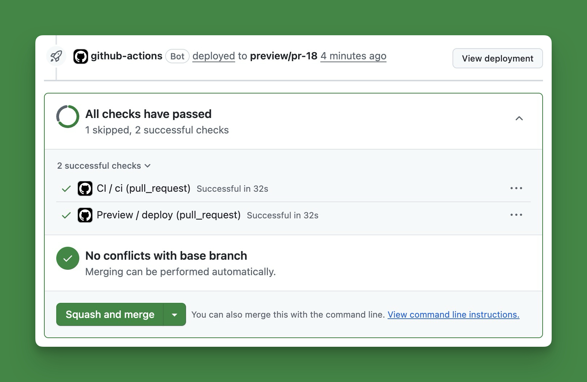

# preview-deployments-skill

An agent skill to add preview deployments to your Cloudflare apps using [Worker Previews](https://developers.cloudflare.com/workers/previews/), GitHub Actions workflows, and the GitHub Deployments API.



## Install

```bash
npx skills add zeke/preview-deployments-skill --global --yes --all
```

## What It Does

- Adds a Worker Preview for each pull request with `wrangler preview` or `cf previews deploy`.
- Publishes preview status through GitHub Deployments, not PR comments.
- Helps choose between shared staging, shared production, or per-PR resources.
- Tears previews down when PRs close or merge.
- Falls back to a separate Worker per PR when an app needs something Previews can't do yet, like Queue consumers or crons.

## More Skills

Browse more skills at [zeke/skills](https://github.com/zeke/skills).
